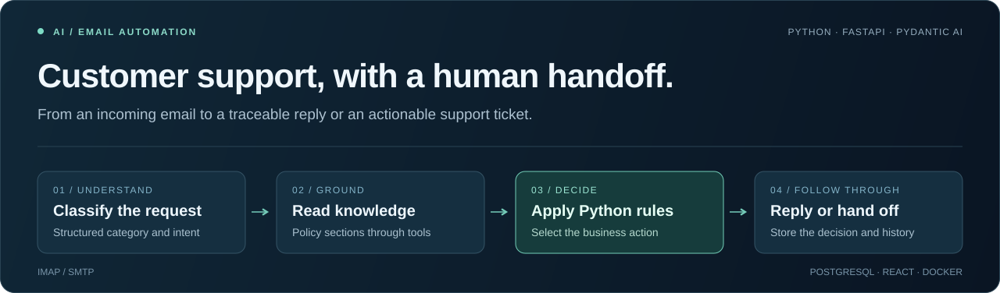
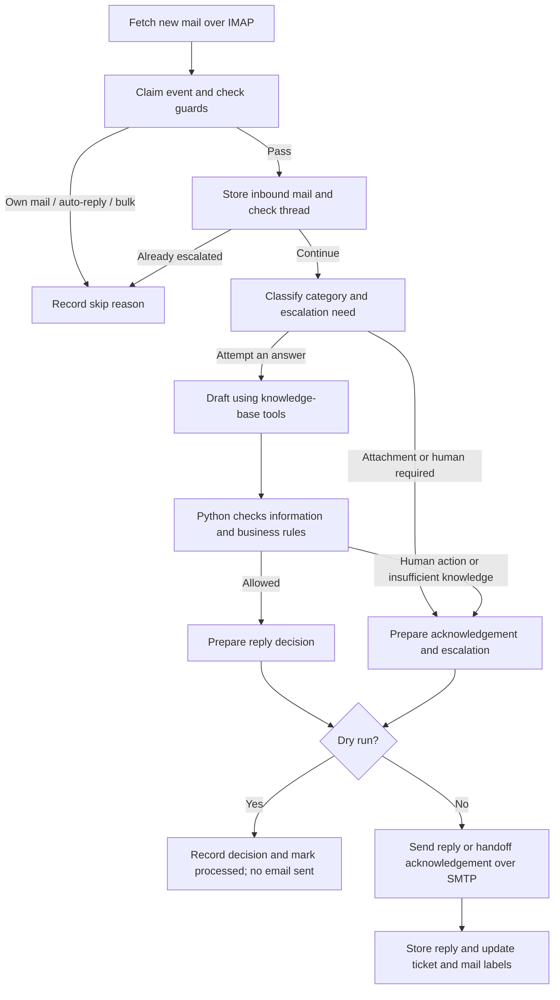

# AI Customer Support

**Turn incoming email into traceable support tickets: classify requests, read policy, draft replies, and hand cases to a human through Python business rules.**

[](https://github.com/Doro-6/ai-customer-support/actions/workflows/ci.yml)

[](LICENSE)

[简体中文](README.md) · English



[Features](#features-and-examples) · [Workflow](#workflow) · [Quickstart](#quickstart) · [Evaluation](#tests-and-evaluation) · [Deployment](#deployment-and-operations)

Built around **Harbor & Pine**, a fictional home and outdoor store, this project connects email, LLM tool calling, business rules, ticket storage, and an admin dashboard. Its architecture follows the [Datalumina full-stack AI engineering course](https://learn.datalumina.com/docs/customer-support-automation), with adaptations for IMAP/SMTP, DeepSeek, and a locally accessible cloud host.

The core design: **models extract facts and draft suggestions; Python selects the processing branch.** Refunds, shipments, and replacements remain human tasks, with proposed actions and decision reasons recorded in tickets.

## Features and examples

| Capability | Implementation |
| --- | --- |
| Email integration | IMAP intake and SMTP replies; MIME parsing, Chinese encodings, HTML bodies, and quoted-history handling |
| Classification and drafting | A classifier selects the category and escalation flag; a drafting agent reads policy through tools and returns Pydantic-validated output |
| Business rules | Python uses order details, delivery age, fault type, and part information to select follow-up questions, checks, or a human action |
| Human handoff | A `needs-human` label and `proposed_action`; automatic replies pause while a thread is escalated |
| Processing records | Events, tickets, and messages; event claims keyed on `Message-ID`, with a failure retry limit |
| Admin dashboard | Events and errors, ticket conversations, knowledge-base editing, and manual inbox checks |

These are intended outcomes represented in the rules and evaluation cases. Actual model behavior must be evaluated:

| Incoming request | Intended handling |
| --- | --- |
| Product specifications, assembly, or general return procedures | Draft an answer from the knowledge base |
| Missing accessory without an order number | Ask for the necessary details |
| Missing accessory with complete order details | Hand off with a proposed action such as `ship-part` |
| Refund request, request for a person, or email with attachments | Escalate to a human |
| Our own mail, automatic replies, or bulk mail | Skip through the initial guards |

## Workflow



The knowledge tools are `list_sections()` and `get_section(section)`, which read database entries by business section. This implementation does not use embeddings or vector retrieval.

### Stack

| Layer | Technologies |
| --- | --- |
| Backend and orchestration | Python 3.13+, FastAPI, Pydantic AI |
| Models | DeepSeek, with separately configured classification and drafting models |
| Data and email | PostgreSQL / Supabase, psycopg, IMAP, SMTP |
| Dashboard | React, TypeScript, Vite, shadcn/ui, Tailwind CSS |
| Validation and delivery | Offline self-tests, pydantic-evals, GitHub Actions, Docker Compose |

## Quickstart

### 1. Install and run offline checks

Install [uv](https://docs.astral.sh/uv/). The project pins Python 3.13 in `.python-version`; uv can fetch the interpreter.

```bash
git clone https://github.com/Doro-6/ai-customer-support.git
cd ai-customer-support
uv sync --locked
uv run python -m scripts.mailbox_selftest
```

The **27 offline checks** cover parsing, thread formatting, guards, and reply subjects. No mailbox, database, or model credentials are required for this step.

### 2. Configure services

A full run needs a reachable PostgreSQL / Supabase database, a DeepSeek API key, and a test mailbox with IMAP/SMTP enabled. Building the dashboard also requires **Node.js 22+**.

```bash
cp .env.example .env
```

Fill in the service credentials and dashboard password. Set `PIPELINE_DRY_RUN=1` for initial integration checks.

> **Dry runs write to the database and mark mail as processed; they only suppress outgoing replies.** Use a test mailbox and test messages. After disabling dry run, use fresh messages to check actual delivery.

<details>
<summary>Environment variables</summary>

| Variable | Purpose |
| --- | --- |
| `MAIL_ADDRESS` / `MAIL_AUTH_CODE` | Support address and IMAP/SMTP app password, not the mailbox login password |
| `IMAP_HOST` / `IMAP_PORT` | Default: `imap.qq.com:993` |
| `SMTP_HOST` / `SMTP_PORT` | Default: `smtp.qq.com:465`; port 587 uses STARTTLS |
| `DATABASE_URL` | PostgreSQL connection string; use a reachable session-pooler endpoint for Supabase where appropriate |
| `DEEPSEEK_API_KEY` | Model service key |
| `CLASSIFIER_MODEL` / `AGENT_MODEL` | Example defaults: `deepseek:deepseek-flash` / `deepseek:deepseek-v4-pro`; confirm that the models are available to your account |
| `DASHBOARD_USERNAME` / `DASHBOARD_PASSWORD` | Dashboard login; an empty password makes `/api/*` return 401 |
| `POLL_INTERVAL_SECONDS` | Polling interval: 30 seconds in `.env.example`, 60 in code if unset |
| `PIPELINE_DRY_RUN` | `1` for dry runs; `0` enables actual replies |

See [`.env.example`](.env.example) for the full configuration. `.env` is excluded from Git and image build context.

</details>

### 3. Initialize the database and knowledge base

```bash
uv run python -m scripts.db_migrate
uv run python -m scripts.seed_knowledge_base
```

The migration helper executes SQL from [`supabase/migrations/`](supabase/migrations/) through psycopg; the Supabase CLI is not required. The seeder splits six Markdown files into database entries at `##` headings.

### 4. Build the dashboard and start services

```bash
npm --prefix dashboard ci
npm --prefix dashboard run build
```

Start the API and dashboard in one terminal:

```bash
uv run fastapi dev app/main.py --host 127.0.0.1
```

Start the poller in another:

```bash
uv run python -m app.poller
```

Open <http://127.0.0.1:8000/> to log in. The dashboard has **Events, Tickets, and Knowledge base** tabs. <http://127.0.0.1:8000/health> reports API process health.

## Tests and evaluation

| Check | Coverage | External requirements |
| --- | --- | --- |
| Offline self-test | 27 checks: MIME, GB2312, HTML bodies, quoted history, thread formatting, guards, and reply subjects | No credentials or network services |
| Model evaluation | 18 golden emails: product questions, faults, refunds, human requests, prompt injection, and more | Model API key, database, and seeded knowledge base |
| CI | Python compilation, offline checks, frontend type checking and build | GitHub Actions; live model evaluation is excluded |

```bash
uv run python -m scripts.mailbox_selftest
uv run python -m evals.run_evals
```

The online evaluators compare `section` and `action`. They do not measure overall reply quality, safety, or business impact. This repository provides cases and a runner; results should be taken from an actual evaluation report.

Evaluation uses `max_concurrency=1` to avoid cross-event-loop HTTP client issues in the current synchronous setup. See [`evals/`](evals/) and the [CI workflow](.github/workflows/ci.yml).

## Code guide

| Entry point | What to inspect |
| --- | --- |
| [`app/pipeline.py`](app/pipeline.py) | Claim, store, decide, send, and update one message |
| [`app/ai/decide.py`](app/ai/decide.py), [`rules.py`](app/ai/rules.py) | How model suggestions enter business rules and trigger handoff |
| [`app/ai/agent.py`](app/ai/agent.py), [`schemas.py`](app/ai/schemas.py) | Knowledge tools, output validation, and structured data |
| [`app/gmail.py`](app/gmail.py), [`guards.py`](app/guards.py) | IMAP/SMTP integration, parsing, thread reconstruction, and loop prevention |
| [`app/db.py`](app/db.py) | Events, tickets, messages, and knowledge-base access |
| [`app/main.py`](app/main.py), [`dashboard/`](dashboard/) | Dashboard endpoints, authentication, and frontend |
| [`scripts/`](scripts/), [`knowledge_base/`](knowledge_base/) | Checks and deployment helpers; six policy sections |

## Engineering decisions and course adaptations

| Decision | Implementation and trade-off |
| --- | --- |
| Separate model output from business actions | Pydantic defines categories, facts, and replies; Python calculates proposed actions such as checks, shipments, or replacements |
| Replace Gmail API with IMAP/SMTP | Preserve the client interface while adapting app-password login; `app/gmail.py` retains its historical name |
| Reconstruct conversations from headers | Use the root `Message-ID` in `References` to organize a thread |
| Identify events by `Message-ID` | Reduce errors caused by IMAP UID reuse; email delivery and database updates remain non-atomic, so exactly-once delivery is not guaranteed |
| Prevent reply loops | Append outgoing copies for context and skip them through own-mail guards |
| Adapt structured output for DeepSeek | Both agents use `thinking=False` with the current forced-tool-calling setup |
| Separate API and polling | Run two Compose services from one image; serve the built frontend through FastAPI |

## Deployment and operations

Docker Compose runs the API and poller separately. Its API port is bound to the host's loopback interface; access the dashboard through an SSH tunnel.

- [Deployment guide](DEPLOY.md): host setup, configuration, deployment, and updates.
- [Operations guide, in Chinese](OPERATIONS.md): human handoff, SSH access, logs, and troubleshooting.
- [Compose configuration](docker-compose.yml): services, port mapping, and log rotation.

Business endpoints under `/api/*` use HTTP Basic; `/health` is unauthenticated. Follow the SSH-tunnel deployment to avoid exposing plaintext HTTP authentication. `/health` checks the API process only, not mailbox, database, or model availability.

## Current boundaries

- A single-host application and engineering practice project for a fictional store; no multi-tenancy, roles, or ticket assignment.
- Section-based knowledge access, without semantic retrieval, vector indexing, or reranking.
- Risk detection, extracted facts, and reply text still depend on the model; rule branches cannot guarantee correct content.
- Logs, event records, and a basic health endpoint exist; proactive alerts and full monitoring do not.
- No external tools execute refunds, shipments, or replacements; a human performs those actions.
- Dry runs, failure retries, and recovery after interruption need validation with a test mailbox and the operations workflow.

## Credits and license

Architecture and course material: [Datalumina](https://learn.datalumina.com/docs/customer-support-automation). This repository implements the course approach with the adaptations above. The brand, example messages, and business scenario are for demonstration.

Released under the [MIT License](LICENSE).
