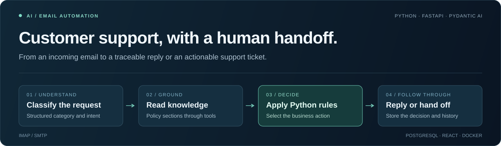
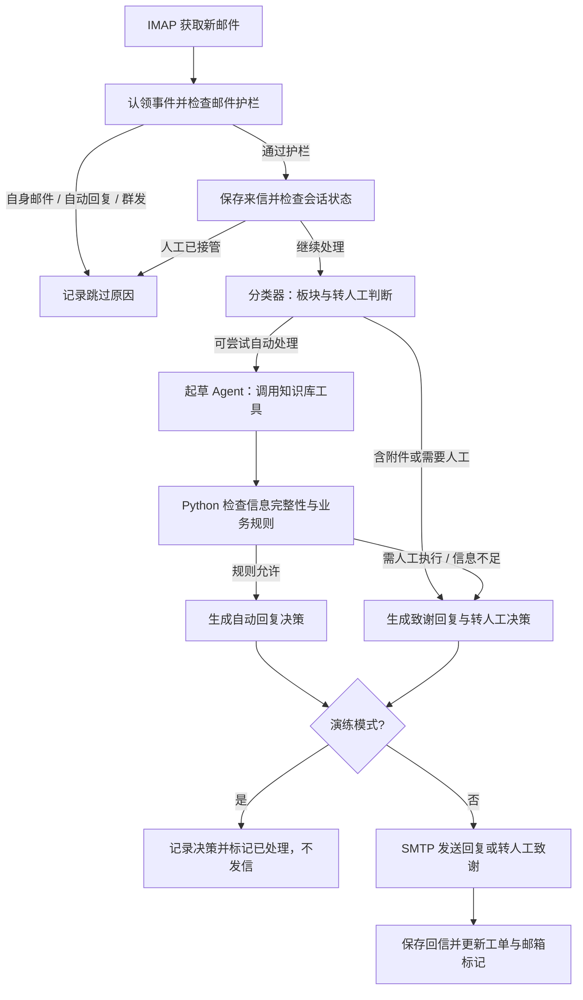

# AI 客服邮件助手

**将客户来信转化为可追踪的客服工单：自动分类、查阅知识库、起草回复，并按业务规则转交人工。**

[](https://github.com/Doro-6/ai-customer-support/actions/workflows/ci.yml)

[](LICENSE)

简体中文 · [English](README.en.md)



[功能与示例](#功能与示例) · [处理流程](#处理流程) · [快速开始](#快速开始) · [测试与评测](#测试与评测) · [部署与运维](#部署与运维)

本项目以虚构的家居与户外用品店 **Harbor & Pine** 为业务场景，串联邮箱接入、LLM 工具调用、业务规则、工单存储和管理看板。架构参考 [Datalumina 全栈 AI 工程课程](https://learn.datalumina.com/docs/customer-support-automation)，并实现了 IMAP/SMTP、DeepSeek 和国内云主机的适配。

核心设计是 **模型提取信息、起草建议，Python 决定处理分支**。退款、补发、换货等执行动作交由人工，系统在工单中记录建议动作与处理原因。

## 功能与示例

| 能力 | 已实现内容 |
| --- | --- |
| 邮件接入 | IMAP 收信、SMTP 回信；处理 MIME、中文编码、HTML 正文和引用历史 |
| 分类与起草 | 分类器识别业务板块和转人工需求；起草 Agent 通过工具读取知识库，返回 Pydantic 结构化结果 |
| 业务规则 | Python 根据订单号、到货天数、故障类型和配件信息，选择补充信息、检查步骤或人工处理 |
| 人工接管 | 标记 `needs-human`，保存 `proposed_action`；人工接管期间跳过该会话的自动回复 |
| 处理记录 | 存储事件、工单和往来消息；基于 `Message-ID` 认领事件，失败处理设有重试上限 |
| 管理看板 | 查看事件与错误、阅读工单会话、编辑知识库、手动触发收件箱检查 |

以下是代码规则和评测用例中的典型场景，模型输出仍需通过实际评测验证：

| 来信场景 | 预期处理 |
| --- | --- |
| 询问产品规格、安装方式或一般退货流程 | 从知识库起草回复 |
| 报告缺少配件，但没有提供订单号 | 先询问必要信息 |
| 缺少配件且订单信息完整 | 转人工，并记录如 `ship-part` 的建议动作 |
| 要求退款、人工联系，或来信含附件 | 转人工处理 |
| 自己发出的邮件、自动回复、群发邮件 | 由前置护栏跳过 |

## 处理流程



知识库工具是 `list_sections()` 和 `get_section(section)`：按业务板块读取数据库中的条目。当前实现不包含向量检索或 Embedding。

### 技术栈

| 层级 | 技术 |
| --- | --- |
| 后端与编排 | Python 3.13+、FastAPI、Pydantic AI |
| 模型 | DeepSeek；分类与起草模型分别配置 |
| 数据与邮箱 | PostgreSQL / Supabase、psycopg、IMAP、SMTP |
| 管理看板 | React、TypeScript、Vite、shadcn/ui、Tailwind CSS |
| 验证与交付 | 离线自检、pydantic-evals、GitHub Actions、Docker Compose |

## 快速开始

### 1. 安装依赖并运行离线自检

准备 [uv](https://docs.astral.sh/uv/)；项目使用 Python 3.13，uv 可按 `.python-version` 获取对应解释器。

```bash
git clone https://github.com/Doro-6/ai-customer-support.git
cd ai-customer-support
uv sync --locked
uv run python -m scripts.mailbox_selftest
```

这一步不连接邮箱、数据库或模型服务，可先验证 **27 项**邮件解析、会话渲染、护栏与回复主题检查。

### 2. 配置外部服务

完整运行需要可连接的 PostgreSQL / Supabase 数据库、DeepSeek API Key，以及已开启 IMAP/SMTP 的测试邮箱。构建看板还需要 **Node.js 22+**。

```bash
cp .env.example .env
```

在 `.env` 中填写连接信息和看板密码，首次联调建议设置 `PIPELINE_DRY_RUN=1`。

> **演练模式会写入数据库并将邮件标记为已处理，只是不发送回复。** 使用测试邮箱与测试来信验证流程；关闭演练模式后，使用新的测试来信检查真实发送。

<details>
<summary>环境变量说明</summary>

| 变量 | 用途 |
| --- | --- |
| `MAIL_ADDRESS` / `MAIL_AUTH_CODE` | 客服邮箱与 IMAP/SMTP 授权码，授权码不是邮箱登录密码 |
| `IMAP_HOST` / `IMAP_PORT` | 默认 `imap.qq.com:993` |
| `SMTP_HOST` / `SMTP_PORT` | 默认 `smtp.qq.com:465`；端口 587 使用 STARTTLS |
| `DATABASE_URL` | PostgreSQL 连接串；Supabase 可使用可达的 Session pooler 地址 |
| `DEEPSEEK_API_KEY` | 模型服务密钥 |
| `CLASSIFIER_MODEL` / `AGENT_MODEL` | 示例默认 `deepseek:deepseek-flash` / `deepseek:deepseek-v4-pro`，需确认账号可访问对应模型 |
| `DASHBOARD_USERNAME` / `DASHBOARD_PASSWORD` | 看板登录；密码为空时 `/api/*` 返回 401 |
| `POLL_INTERVAL_SECONDS` | 轮询间隔；`.env.example` 为 30 秒，未设置时代码默认 60 秒 |
| `PIPELINE_DRY_RUN` | `1` 为演练模式；`0` 开启实际回信 |

完整配置见 [`.env.example`](.env.example)。`.env` 已加入 Git 和镜像构建的忽略规则。

</details>

### 3. 初始化数据库与知识库

```bash
uv run python -m scripts.db_migrate
uv run python -m scripts.seed_knowledge_base
```

迁移脚本通过 psycopg 执行 [`supabase/migrations/`](supabase/migrations/) 中的 SQL，无需安装 Supabase CLI。知识库脚本将六个 Markdown 文件按 `##` 标题拆为数据库条目。

### 4. 构建看板并启动服务

```bash
npm --prefix dashboard ci
npm --prefix dashboard run build
```

在一个终端启动 API 和看板：

```bash
uv run fastapi dev app/main.py --host 127.0.0.1
```

在另一个终端启动邮件轮询：

```bash
uv run python -m app.poller
```

打开 <http://127.0.0.1:8000/> 登录看板；<http://127.0.0.1:8000/health> 返回进程健康状态。看板包含 **Events、Tickets、Knowledge base** 三个页面。

## 测试与评测

| 验证方式 | 范围 | 外部依赖 |
| --- | --- | --- |
| 离线自检 | 27 项：MIME、GB2312、HTML 正文、引用剥离、会话渲染、护栏、回复主题 | 无凭据、无网络服务 |
| 模型评测 | 18 条黄金邮件：产品咨询、售后故障、退款、人工请求、提示注入等 | 模型 API Key、数据库与已导入的知识库 |
| CI | Python 编译检查、离线自检、前端类型检查与构建 | GitHub Actions；不执行在线模型评测 |

```bash
uv run python -m scripts.mailbox_selftest
uv run python -m evals.run_evals
```

在线评测比较 `section`（分类板块）和 `action`（回复或转人工），不等同于回复质量、安全性或真实业务收益评估。仓库提供评测集与运行方式，具体结果以实际运行报告为准。

评测采用 `max_concurrency=1`，避免当前同步调用方式下 HTTP 客户端跨事件循环的问题。用例与评估器见 [`evals/`](evals/)，自动检查见 [CI 工作流](.github/workflows/ci.yml)。

## 代码导览

| 阅读入口 | 关注点 |
| --- | --- |
| [`app/pipeline.py`](app/pipeline.py) | 单封邮件的认领、保存、决策、发送与状态更新 |
| [`app/ai/decide.py`](app/ai/decide.py)、[`rules.py`](app/ai/rules.py) | 模型建议如何进入业务规则，何时转交人工 |
| [`app/ai/agent.py`](app/ai/agent.py)、[`schemas.py`](app/ai/schemas.py) | 知识库工具、输出校验与结构化数据模型 |
| [`app/gmail.py`](app/gmail.py)、[`guards.py`](app/guards.py) | IMAP/SMTP 适配、邮件解析、会话重建和防循环护栏 |
| [`app/db.py`](app/db.py) | 事件、工单、消息与知识库访问 |
| [`app/main.py`](app/main.py)、[`dashboard/`](dashboard/) | 看板 API、认证与前端界面 |
| [`scripts/`](scripts/)、[`knowledge_base/`](knowledge_base/) | 自检与部署工具、六个业务知识板块 |

## 工程设计与课程适配

| 设计选择 | 实现与取舍 |
| --- | --- |
| 模型与业务动作分离 | Pydantic 定义分类、事实和回复结构；Python 计算补发、检查或换货等建议动作 |
| IMAP/SMTP 替换 Gmail API | 保留原有客户端调用接口，适配授权码登录；`app/gmail.py` 沿用历史文件名 |
| 用邮件头重建会话 | 从 `References` 获取根 `Message-ID`，通过邮件头组织往来记录 |
| 用 `Message-ID` 标识事件 | 减少 IMAP UID 复用造成的误判；发送与数据库写入仍非原子操作，不承诺严格仅发送一次 |
| 防止回复循环 | SMTP 回信副本写回邮箱以保留上下文，由自身邮件护栏阻止再次回复 |
| DeepSeek 结构化输出适配 | 分类器与起草 Agent 设置 `thinking=False`，配合当前强制工具调用方式 |
| 分离 API 与轮询进程 | 同一镜像运行两个 Compose 服务；前端构建产物由 FastAPI 托管 |

## 部署与运维

Docker Compose 将 API 与轮询进程分开运行，API 端口绑定宿主机回环地址，通过 SSH 隧道访问看板。

- [部署指南](DEPLOY.md)：主机准备、环境配置、容器部署与更新。
- [运维手册](OPERATIONS.md)：人工接管流程、SSH 隧道、日志与故障排查。
- [Compose 配置](docker-compose.yml)：服务、端口映射和日志轮转。

看板业务接口 `/api/*` 使用 HTTP Basic，`/health` 不要求登录。按现有部署方案通过 SSH 隧道访问，避免直接暴露明文 HTTP 认证。`/health` 仅确认 API 进程响应，不检测邮箱、数据库或模型服务是否可用。

## 当前边界

- 面向虚构店铺的单机应用与工程实践项目；尚未提供多租户、角色权限或工单分配。
- 知识库采用板块查询，尚未引入语义检索、向量索引或重排。
- 风险识别、事实抽取和回复文本仍依赖模型；规则分支不能保证模型内容始终正确。
- 已有日志、事件记录和基础健康接口，尚无主动告警或完整监控。
- 没有自动执行退款、发货或换货的外部工具；这些动作由人工完成。
- 演练模式、失败重试和异常中断后的恢复需要结合测试邮箱与运维流程验证。

## 致谢与许可

架构思路与课程材料来自 [Datalumina](https://learn.datalumina.com/docs/customer-support-automation)。本仓库基于课程思路实现，并完成上述技术适配；示例品牌、来信和业务场景用于演示。

本项目使用 [MIT License](LICENSE)。
